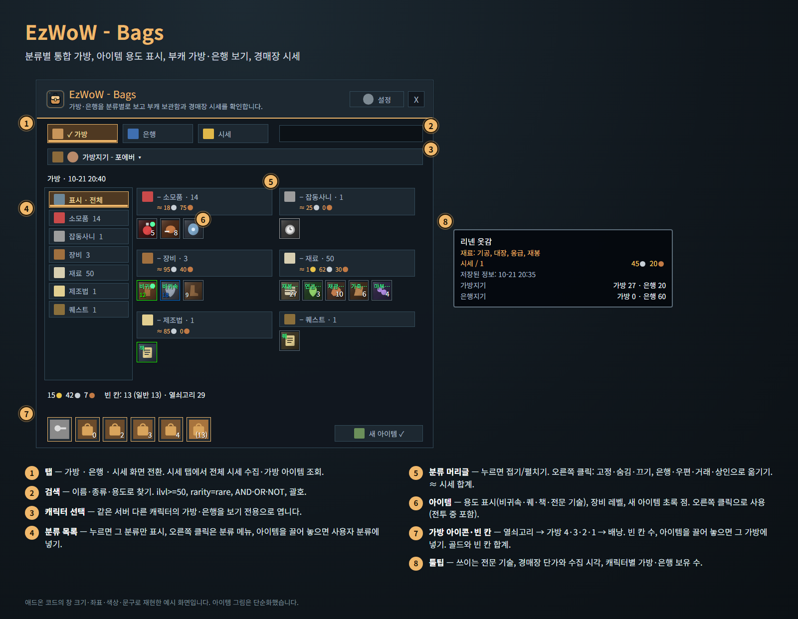
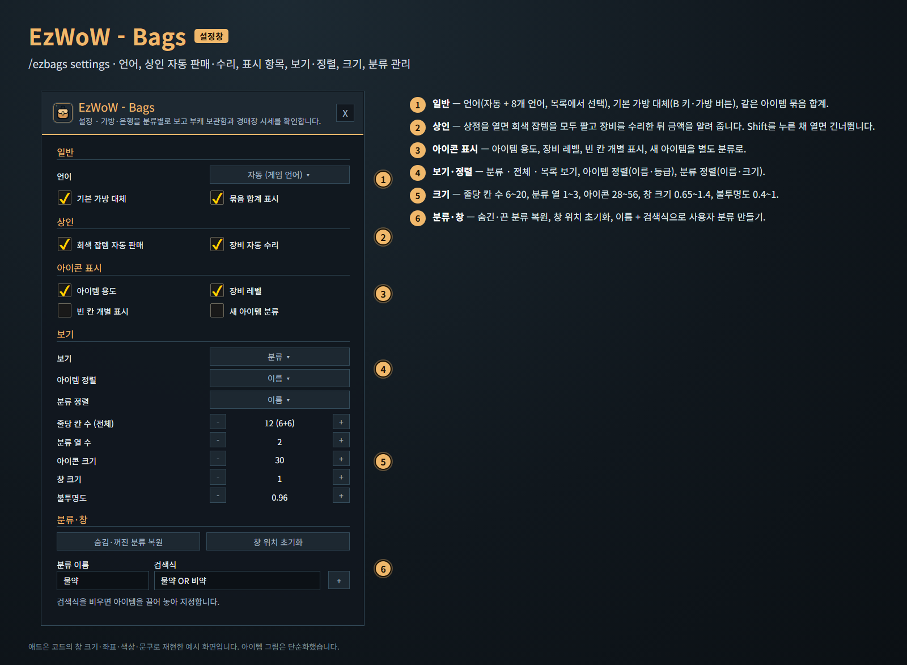
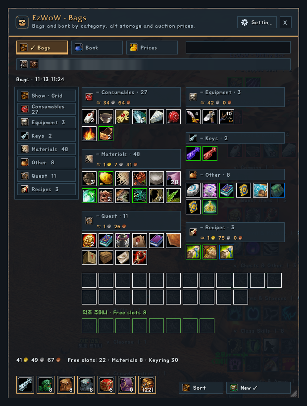
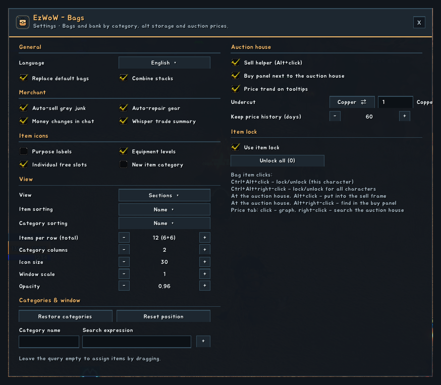
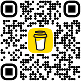

# EzWoW - Bags (`EzWoW-Bags`)

## CurseForge

- **Project ID / 프로젝트 ID:** `1757680`
- **Project page / 프로젝트 페이지:** [EzWoW-Bags](https://www.curseforge.com/projects/1757680)

**[한국어](#한국어) · [English](#english)**

WoW Forever (`Interface: 16001`) · `/ezbags`, `/ezb`

---

## 한국어

### 개요

가방·은행을 하나의 창에서 **분류별**로 보여 주는 가방 애드온입니다. 아이콘 위에 **아이템 용도**(퀘·비귀속·책·연금·재봉 같은 전문 기술)를 표시하고, **다른 캐릭터의 가방·은행**을 보기 전용으로 열어 볼 수 있으며, **경매장 시세**를 날마다 기록해 툴팁·분류 합계·**30일 시세 그래프**로 보여 줍니다. 경매장에서는 **판매 도우미**(Alt+클릭, 판매 목록)와 **구매 창**을 쓸 수 있고, 상점을 열면 **회색 잡템 자동 판매**와 **장비 자동 수리**를 해 줍니다. 아끼는 아이템은 **잠가서** 자동 판매·일괄 이동·경매 등록에서 뺄 수 있습니다.

### 화면 미리보기

> 실제 게임 화면입니다(WoW Forever, 한국어 클라이언트). 캐릭터 · 다른 플레이어 이름과 채팅 내용은 가렸습니다.

### 설치

1. `EzWoW-Bags` 폴더를 `Interface/AddOns/` 폴더에 넣습니다. 최종 위치는 `Interface/AddOns/EzWoW-Bags/EzWoW-Bags.toc`입니다.
2. 캐릭터 선택 화면의 **애드온** 목록에서 켭니다. 다른 가방 대체 애드온은 꺼 두세요.
3. **B 키** 또는 기본 가방 버튼을 누르면 통합 창이 열립니다.

### 사용법

| 번호 | 부분 | 설명 |
|---|---|---|
| ① | 탭 | **가방 · 은행 · 시세** 화면을 바꿉니다. |
| ② | 검색 | 이름·종류·용도로 찾습니다. `ilvl>=50`, `rarity=rare`, `AND / OR / NOT`, 괄호, 따옴표를 쓸 수 있습니다. 검색 중에는 칸 테두리가 강조색이 되고, 오른쪽 × 버튼으로 바로 지웁니다. |
| ③ | 캐릭터 선택 | 같은 서버의 다른 캐릭터를 고르면 그 캐릭터가 마지막으로 저장한 가방·은행을 **보기 전용**으로 보여 줍니다. 은행은 그 캐릭터로 은행을 한 번 열어야 저장됩니다. |
| ④ | 분류 목록 | 누르면 그 분류만 보여 줍니다. 오른쪽 클릭은 분류 메뉴입니다. 아이템을 끌어다 놓으면 그 사용자 분류에 넣습니다. |
| ⑤ | 분류 머리글 | 누르면 접고 펼칩니다. 오른쪽 클릭: 고정 · 숨김 · 끄기, 사용자 분류 순서·검색식·삭제, 은행·우편·거래·상인으로 옮기기. 시세를 아는 아이템은 합계(≈)를 보여 줍니다. |
| ⑥ | 아이템 | 아이콘 위에 용도(**비귀속 · 퀘 · 책 · 전문 기술**), 오른쪽 위에 장비 레벨, 왼쪽 아래에 새 아이템 초록 점과 **잠금 자물쇠**를 표시합니다. 왼쪽 클릭 집기, **오른쪽 클릭 사용**(물약·음식·귀환석 등, 전투 중에도), Shift 클릭 링크·나누기, **Ctrl+Alt+클릭 잠금**. 현재 캐릭터의 실제 가방과 열린 은행에서만 동작합니다. |
| ⑦ | 가방 아이콘 · 정리 | 열쇠고리 → 재료 가방 → 가방 4·3·2·1 → 배낭 순서. 빈 칸 수를 표시하고, 아이템을 끌어 놓으면 그 가방에 넣습니다. 위에는 골드와 빈 칸 합계, 아래쪽 **정리**는 게임의 가방 정리, **새 아이템 ✓**는 초록 점을 지웁니다. |
| ⑧ | 툴팁 | 쓰이는 전문 기술, 잠금 상태, 경매장 단가와 **최근 7일 평균 대비 변화(▲/▼)**, 수집 시각, 같은 서버 캐릭터별 가방·은행 보유 수. 이 애드온이 넣은 줄 아래에 작은 회색 "EzWoW - Bags" 표시가 붙습니다. |
| ⑨ | 시세 그래프 | 시세 탭에서 아이템을 누르면 **최근 30일 동안 조회할 때마다의 최저가**(선과 점)와 등록 수량(막대)을 그래프로 보여 줍니다. 날짜 위에 마우스를 올리면 그날의 가장 낮은 값이 나옵니다. 판매 목록의 **최근 시세**는 마지막으로 조회했을 때의 최저가입니다. |
| ⑩ | 시세 목록 | **전체 시세 수집**(경매장 전체) 또는 **가방 아이템 조회**(가방에 있는 아이템만). 경매장이 열려 있어야 합니다. 왼쪽에서 아이템 종류로 거를 수 있고, 줄을 오른쪽 클릭하면 구매 창에서 찾습니다. |
| ⑪ | 경매장 구매 창 | 경매장을 열면 옆에 붙어 열립니다. 이름으로 검색하면 **최저가부터** 보여 주고, 수량을 넣고 **최저가부터 사기**를 누르면 싼 매물부터 삽니다. **모든 구매는 확인 창**(아이템·수량·단가·합계)을 거치며, 골드가 모자라거나 최근 7일 평균보다 많이 비싸면 경고합니다. |
| ⑫ | 판매 목록 | 가방에서 경매장에 올릴 수 있는 물건을 체크 목록으로 보여 줍니다. 체크한 물건을 하나씩 경매장 판매 창에 올리고 최저가보다 조금 낮은 가격을 넣으며, [올리기](또는 경매장의 등록 버튼)를 누를 때마다 다음 물건으로 넘어갑니다. |

#### 경매장 도우미

- **Alt+클릭**(경매장이 열려 있을 때): 가방 아이템을 경매장 판매 창에 올리고 현재 최저가보다 조금 낮은 가격을 채웁니다. 등록 버튼은 직접 누릅니다. 가격 낮추기는 설정에서 동(기본 1동) 또는 %로 정합니다.
  - 최저가가 내 경매면 같은 가격으로 맞추고, 상점 판매가 아래로는 내리지 않으며, 최근 7일 평균보다 많이 낮으면 알려 줍니다.
- **Alt+오른쪽 클릭**(경매장이 열려 있을 때): 그 아이템을 구매 창에서 찾습니다. 구매 창이 열려 있을 때 아이템을 Shift+클릭해도 이름으로 검색합니다.
- 판매 목록에는 잠근 아이템과 회색 아이템이 나오지 않습니다. 시세가 상점 판매가와 비슷해 상점에 파는 편이 나은 물건은 "상점이 나음"으로 표시하고 **전체 선택**에서 뺍니다.
- 시세는 서버·진영별로 하루 한 점(최저 단가와 등록 수량)씩 쌓이고, 설정한 기간(30~120일, 기본 60일)만 보관합니다.

#### 아이템 잠금

- 가방 아이템 **Ctrl+Alt+클릭**은 이 캐릭터에서, **Ctrl+Alt+오른쪽 클릭**은 계정 전체에서 잠그거나 풉니다.
- 잠근 아이템은 회색 잡템 자동 판매, 분류 이동(상인·우편·거래), 경매장 판매 도우미·판매 목록에서 빠집니다. 은행으로 옮기기는 그대로 됩니다.
- 설정창의 **모든 잠금 해제**로 이 캐릭터와 계정 전체 잠금을 한 번에 풉니다.

#### 그 밖에

- EzWoW - Tooltip이 켜져 있으면 시세 수집은 Tooltip이 맡고 Bags는 그 가격을 함께 씁니다. 툴팁의 시세 줄도 Tooltip이 표시하며, Bags는 그 줄에 7일 평균 대비 변화를 붙입니다.
- EzWoW - Profession Recipes가 켜져 있으면 재료의 쓰임새는 그쪽 툴팁 목록이 보여 주고, Bags의 "재료:" 줄은 나오지 않습니다.
- 상점 창을 열면 가방의 회색(하급) 잡템을 모두 팔고, 수리할 수 있는 상인이면 착용·가방 장비를 모두 수리한 뒤 채팅창에 금액을 알려 줍니다. **Shift를 누른 채 상점을 열면** 둘 다 건너뜁니다. 골드가 모자라면 수리하지 않습니다. 두 기능은 설정창의 **상인** 구역에서 끌 수 있습니다.
- 자동 판매·수리는 원래 EzWoW - Tooltip의 기능이었습니다. 처음 실행할 때 Tooltip에서 고른 설정을 한 번 가져오고, Bags가 켜져 있으면 Tooltip은 이 기능을 쓰지 않습니다.
- **돈 출입 알림**: 돈이 들어오거나 나갈 때마다 금액과 이유(판매·구매·수리·비행·교관·우편·경매장·거래·퀘스트 등)를 채팅창에 알려 줍니다.
- **거래 내역 귓속말**: 다른 플레이어와 거래를 마치면 주고받은 물건과 금액을 상대에게 귓속말로 보냅니다. 두 기능 모두 설정에서 끌 수 있습니다.
- 아래쪽 **정리** 버튼: 게임의 가방 정리 기능으로 가방(은행 탭에서는 열린 은행)을 정리합니다. 전투 중에는 쓸 수 없습니다.
- 전투 중에는 창의 배치·크기를 바꾸지 않고 개수·쿨다운만 갱신합니다. 전투 중에 연 창·닫은 창과 새 배치는 전투가 끝나면 적용됩니다.

#### 분류 머리글로 옮기기

은행·우편·거래·상인 창이 열린 동안 머리글 오른쪽 클릭 → 옮길 곳을 고르면, 아래쪽 **다음 아이템** 버튼을 누를 때마다 실제 묶음 하나씩 옮깁니다. 상인에게는 판매가가 있는 일반·하급 아이템만 팔고, 퀘스트·직접 지정한 아이템과 잠근 아이템은 빼고 팝니다.

### 설정창 (`/ezbags settings`)

| 번호 | 항목 | 기본값 |
|---|---|---|
| ① | 언어 (자동 + 8개 언어) | 자동 |
| ① | 기본 가방 대체 (바로 적용) | 켬 |
| ① | 묶음 합계 표시 | 켬 |
| ② | 회색 잡템 자동 판매 (Shift를 누른 채 상점을 열면 건너뜀) | 켬 |
| ② | 장비 자동 수리 (Shift를 누른 채 상점을 열면 건너뜀) | 켬 |
| ② | 돈 출입 채팅 알림 | 켬 |
| ② | 거래 내역 귓속말 | 켬 |
| ③ | 아이템 용도 · 장비 레벨 | 켬 |
| ③ | 빈 칸 개별 표시 · 새 아이템 분류 | 끔 |
| ④ | 보기: 분류 · 전체 · 목록 | 분류 |
| ④ | 아이템 정렬: 이름 · 등급 / 분류 정렬: 이름 · 크기 | 이름 · 이름 |
| ④ | 줄당 칸 수 (전체) 6~20 · 분류 열 수 1~3 | 12 · 2 |
| ④ | 아이콘 크기 28~56 · 창 크기 0.65~1.4 · 불투명도 0.4~1 | 30 · 1 · 0.96 |
| ⑤ | 숨김·꺼진 분류 복원 · 창 위치 초기화 | - |
| ⑤ | 사용자 분류 만들기: 이름 + 검색식 (검색식을 비우면 아이템을 끌어 놓아 지정) | - |
| ⑥ | 판매 도우미 (Alt+클릭) | 켬 |
| ⑥ | 경매장 옆 구매 창 | 켬 |
| ⑥ | 툴팁에 시세 추세 (7일 평균 대비 ▲/▼) | 켬 |
| ⑥ | 가격 낮추기: 동 0~10000000 또는 % 0~50 (버튼으로 전환) | 1동 |
| ⑥ | 시세 기록 보관 (일) 30~120 | 60 |
| ⑦ | 아이템 잠금 사용 · 모든 잠금 해제 | 켬 |

### 명령어 (`/ezbags`, `/ezb`)

| 명령어 | 설명 |
|---|---|
| `/ezbags` | 통합 창 열기/닫기 |
| `/ezbags bank` | 저장된 은행 보기 |
| `/ezbags settings` | 설정창 |
| `/ezbags scan` | 경매장이 열린 상태에서 전체 시세 수집 |
| `/ezbags debug` | 은행·경매 API 상태와 수집 진행 상황 |

### 저장 데이터

- `EzWoW_BagsDB`: 설정, 캐릭터별 가방·은행·골드, 서버·진영별 경매 시세와 날짜별 시세 기록, 캐릭터별·계정 전체 잠금 목록, 판매 목록의 체크 상태.
- 시세는 즉시구매 가격을 수량으로 나눈 **최저 단가**와 수집 시각입니다. 현재 살 수 있는 가격을 보장하지 않습니다.
- 전문 기술 용도는 EzWoW - Profession Recipes의 포에버 제조법 데이터에서 뽑은 재료 529종입니다(따로 설치할 필요 없음).

<!-- ezwow-pad-share -->
### 게임패드
- 게임패드 UI를 켜면 EzWoW 창을 패드로 다룰 수 있습니다. 방향키로 이동, A(✕)로 누르기, X(□)로 오른쪽 클릭, LB/RB로 스크롤, B(○)로 닫기입니다. 창 아래에 연결된 패드 모양으로 키 안내가 나옵니다.
- 블리자드 창이 열려 있지 않을 때 **보기(Back) / Create 버튼**을 누르면 화면의 EzWoW 프레임(유틸리티 바, 퀘스트 목록 등)으로 이동합니다. 다시 누르거나 B를 누르면 돌아갑니다.
- 다른 버튼을 쓰려면 설정 > 단축키 > 애드온 > EzWoW > "게임패드: EzWoW 창으로 이동/돌아가기"에 지정합니다(EzWoW-MapFinder가 설치돼 있을 때).

### 기록 공유
- 모든 EzWoW 애드온이 함께 쓰는 기록 공유가 **기본으로 켜져 있습니다**. 직접 확인한 퀘스트 NPC, 희귀 몬스터 목격, 아이템 드롭, 채집 위치를 다른 EzWoW 사용자와 나눕니다.
- `/ezshare` 또는 `/공유`: `on` / `off` 켜기·끄기, `channel on` / `channel off` 서버 채널 사용, `status` 현재 상태와 기록 수.

---

## English

### Overview

A bag addon that shows your bags and bank in one window, **grouped by category**. Icons carry a short **purpose label** (quest, BoE, recipe, or the professions that use a reagent), you can open **other characters' bags and banks** read-only, and **auction prices** are recorded every day and shown in tooltips, category totals and a **30-day price graph**. At the auction house you get a **sell helper** (Alt+click and a sell list) and a **buy panel**; at a vendor it **sells grey junk** and **repairs your gear** automatically. Items you want to keep can be **locked** so auto-sell, bulk moves and auction posting leave them alone.

### Screenshots

> In-game screenshots with the addon set to English. The game client is Korean, so game text such as zone, item and spell names stays Korean. Character and player names and chat text are blurred.

### Installation

1. Copy the `EzWoW-Bags` folder into `Interface/AddOns/` (final path `Interface/AddOns/EzWoW-Bags/EzWoW-Bags.toc`).
2. Enable it in the **AddOns** list on the character select screen. Turn off other bag replacement addons.
3. Press **B** or a bag button to open the window.

### How to use

| No. | Part | Description |
|---|---|---|
| ① | Tabs | Switch between **Bags · Bank · Prices**. |
| ② | Search | Name, type or purpose. Supports `ilvl>=50`, `rarity=rare`, `AND / OR / NOT`, brackets and quotes. While searching the box border lights up; the × button on the right clears it. |
| ③ | Character picker | Pick another character on the same realm to see its last saved bags and bank, **read only**. A bank is saved once you open it on that character. |
| ④ | Category list | Click to show only that category; right-click for its menu; drop an item on a custom category to put it there. |
| ⑤ | Category header | Click to collapse. Right-click: pin · hide · disable, custom category order/search/delete, move to bank · mail · trade · vendor. Shows a total (≈) for items with a known price. |
| ⑥ | Items | Purpose label on the icon (**BoE · Q · Recipe · professions**), item level top right, green dot for new items and a **padlock** for locked items bottom left. Left-click picks up, **right-click uses** (potions, food, Hearthstone — also in combat), Shift-click links or splits, **Ctrl+Alt+click locks**. Works on your current character's real bags and an open bank. |
| ⑦ | Bag icons · Sort | Keyring → reagent bag → bags 4·3·2·1 → backpack, with free slot counts; drop an item on a bag to put it there. Gold and free-slot totals above; **Sort** uses the game's own bag sort, **New ✓** clears the green dots. |
| ⑧ | Tooltip | Professions that use the item, lock state, auction unit price with the **change against the 7-day average (▲/▼)** and when it was seen, per-character bag and bank counts on the realm. A small grey "EzWoW - Bags" tag follows the lines this addon adds. |
| ⑨ | Price graph | Click an item on the Prices tab to see its **lowest price at every lookup of the last 30 days** (line and dots) and the listed quantity (bars). Hover a day for its lowest value. The **recent price** in the sell list is the lowest price of the latest lookup. |
| ⑩ | Price list | **Full scan** (whole auction house) or **Scan bag items**. The auction house must be open. Filter by item class on the left; right-click a row to find it in the buy panel. |
| ⑪ | Auction buy panel | Opens beside the auction house. Search by name to see offers **cheapest first**; enter a quantity and press **Buy cheapest first**. **Every purchase goes through a confirm dialog** (item, quantity, unit price, total), with a warning when you lack the gold or the price is far above the 7-day average. |
| ⑫ | Sell list | Lists the bag items that can be auctioned, with check boxes. The checked items go into the auction house sell frame one at a time, priced just under the lowest; each **Post** (or the auction house's own post button) moves on to the next one. |

#### Auction helpers

- **Alt+click** (auction house open): puts a bag item into the auction house sell frame and fills a price just under the current lowest. You press the post button yourself. The undercut is set in copper (default 1) or percent in the settings.
  - When the lowest offer is yours it matches that price, it never goes below the vendor price, and it warns when the price is far below the 7-day average.
- **Alt+right-click** (auction house open): finds the item in the buy panel. Shift-clicking an item while the buy panel is open also searches for it by name.
- Locked and grey items are not in the sell list. Items whose auction price is about the vendor price are marked "shop pays more" and left out of **Select all**.
- Prices are kept per realm and faction as one point per day (lowest unit price and listed quantity) for the number of days you choose (30–120, default 60).

#### Item lock

- **Ctrl+Alt+click** a bag item to lock or unlock it on this character; **Ctrl+Alt+right-click** for all characters.
- Locked items are skipped by auto-selling junk, category moves (vendor, mail, trade) and the auction sell helper and sell list. Moving to the bank still works.
- **Unlock all** in the settings clears this character's and the account-wide locks.

#### More

- With EzWoW - Tooltip enabled, Tooltip collects prices and Bags shares them. Tooltip also shows the price line, and Bags adds the 7-day trend to it.
- With EzWoW - Profession Recipes enabled, its tooltip list shows where a reagent is used and Bags leaves out its "Materials:" line.
- When a vendor opens, every grey (poor) item in your bags is sold, and at a vendor who can repair all worn and carried gear is repaired; the gold is reported in chat. **Hold Shift while opening the vendor** to skip both. Repair is skipped when you do not have enough gold. Both can be turned off in the **Merchant** section of the settings.
- Auto-sell and auto-repair used to be EzWoW - Tooltip features. On the first start the choices made there are carried over once; while Bags is enabled, Tooltip leaves these to Bags.
- **Money in chat**: each time gold comes in or goes out, the amount and the reason (selling, buying, repair, flights, trainers, mail, auction house, trade, quests…) show in chat.
- **Trade summary whisper**: after a trade, the items and gold that changed hands are whispered to the other player. Both can be turned off in the settings.
- **Sort** button (bottom): sorts your bags (or the open bank on the Bank tab) with the game's own sort. Not available in combat.
- In combat the window keeps its layout and size and only updates counts and cooldowns; opening, closing and the new layout happen when combat ends.

#### Moving a whole category

While the bank, mail, trade or a vendor is open, right-click a header → pick the target; each click on **Next item** at the bottom moves one real stack. A vendor only gets common and poor items with a sell price; quest items, items you assigned yourself and locked items are left out.

### Settings window (`/ezbags settings`)

| No. | Option | Default |
|---|---|---|
| ① | Language (automatic + 8 languages) | Automatic |
| ① | Replace default bags (applies immediately) | On |
| ① | Combine stacks | On |
| ② | Auto-sell grey junk (hold Shift while opening the vendor to skip) | On |
| ② | Auto-repair gear (hold Shift while opening the vendor to skip) | On |
| ② | Money changes in chat | On |
| ② | Whisper trade summary | On |
| ③ | Purpose labels · Equipment levels | On |
| ③ | Individual free slots · New item category | Off |
| ④ | View: Sections · Grid · List | Sections |
| ④ | Item sorting: Name · Quality / Category sorting: Name · Size | Name · Name |
| ④ | Items per row (total) 6–20 · Category columns 1–3 | 12 · 2 |
| ④ | Icon size 28–56 · Window scale 0.65–1.4 · Opacity 0.4–1 | 30 · 1 · 0.96 |
| ⑤ | Restore categories · Reset position | - |
| ⑤ | New custom category: name + search (leave the search empty to assign items by dragging) | - |
| ⑥ | Sell helper (Alt+click) | On |
| ⑥ | Buy panel next to the auction house | On |
| ⑥ | Price trend on tooltips (▲/▼ against the 7-day average) | On |
| ⑥ | Undercut: copper 0–10000000 or percent 0–50 (button switches) | 1 copper |
| ⑥ | Keep price history (days) 30–120 | 60 |
| ⑦ | Use item lock · Unlock all | On |

### Slash commands (`/ezbags`, `/ezb`)

| Command | Description |
|---|---|
| `/ezbags` | Open/close the window |
| `/ezbags bank` | Show the saved bank |
| `/ezbags settings` | Settings |
| `/ezbags scan` | Full price scan while the auction house is open |
| `/ezbags debug` | Bank/auction API state and scan progress |

### Saved data

- `EzWoW_BagsDB`: settings, every character's bags, bank and gold, auction prices and price history (one record per lookup) per realm and faction, per-character and account-wide item locks, the check marks of the sell list.
- A price is the lowest buyout per item and the time it was seen — not a guarantee of what you can buy now.
- Profession use comes from the WoW Forever recipe data of EzWoW - Profession Recipes (529 reagents; no need to install it).

### Gamepad
- With the gamepad UI on, EzWoW windows work with a gamepad: D-pad to move, A (✕) to press, X (□) for right-click, LB/RB to scroll, B (○) to close. A key guide in your pad's button style shows under the window.
- With no game window open, press **View (Back) / Create** to move to the EzWoW frames on screen (Utility Bar, quest list and more). Press it again or B to go back.
- To use another button, set Key Bindings > AddOns > EzWoW > "Gamepad: move to / leave the EzWoW frames" (with EzWoW-MapFinder installed).

### Record sharing
- Record sharing, used by all EzWoW addons, is **on by default**. Quest NPCs, rare monster sightings, item drops and gathering spots you have seen yourself are shared with other EzWoW users.
- `/ezshare`: `on` / `off` to turn it on or off, `channel on` / `channel off` for the server channel, `status` for the current state and record counts.

---

## Support / 후원

If you find this addon useful, you can support its development.

애드온이 도움이 되셨다면 개발 후원으로 응원해 주세요.

[Buy Me a Coffee ☕](https://buymeacoffee.com/qqhrqqhr2)

