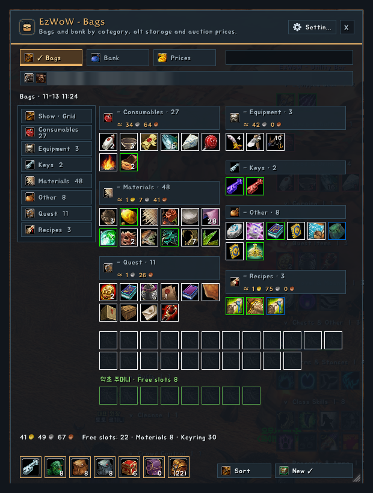
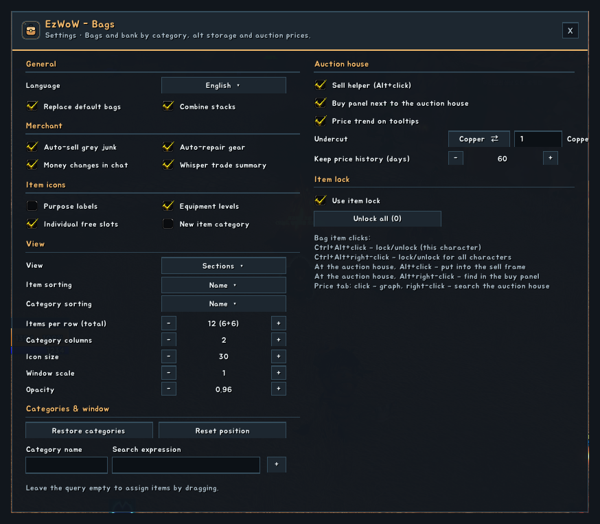
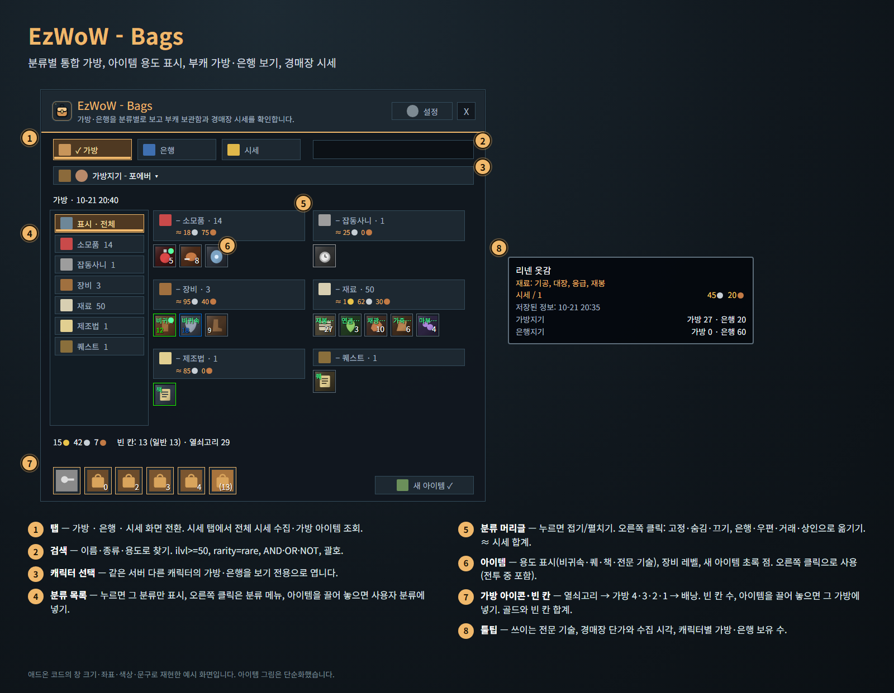
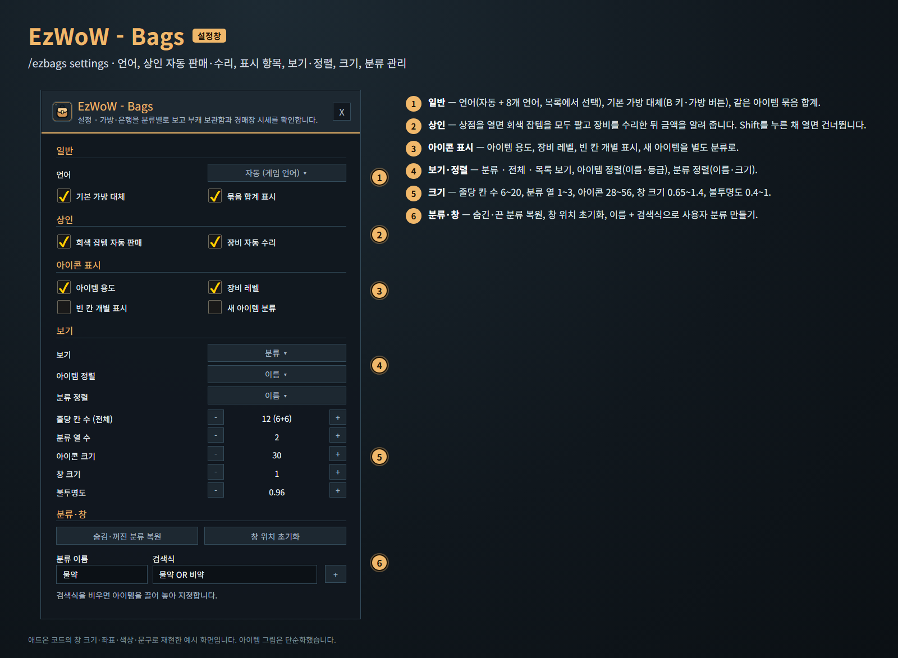

<!--
CurseForge summary (EN): All-in-one bag window by category with purpose labels and item lock, alt bags and banks, auction price history and graph, auction buy and sell helpers, and automatic junk selling and repair.
CurseForge summary (KO): 분류별 통합 가방, 아이템 용도·잠금, 부캐 가방·은행 보기, 경매장 시세 기록·그래프, 경매장 구매·판매 도우미, 상점 회색 잡템 자동 판매·자동 수리.
-->

# EzWoW - Bags

**English** · [한국어](#한국어)

A bag addon for WoW Forever that shows your bags and bank in one window, grouped by category. Icons carry a short purpose label, you can look into your other characters' bags and banks, and auction prices are recorded every day and shown in tooltips, category totals and a 30-day graph. At the auction house it helps you post and buy, at a vendor it sells grey junk and repairs your gear, and locked items are never sold or moved by mistake.

*Mock-ups rebuilt from the window sizes, coordinates, colours and strings in the addon code. Item art is simplified; names and prices are made up.*

## Features

### One bag window
- Bags (and the bank) in one window, grouped into categories: equipment, consumables, materials, quest items, recipes, junk and your own custom categories.
- Three views: **Sections**, **Grid** and **List**; sort items by name or quality and categories by name or size.
- Category list on the left: click to show one category, right-click for its menu, drop an item on a custom category to put it there.
- Category headers fold and unfold; right-click to pin, hide or disable, or to move the whole category to the bank, mail, trade or a vendor one stack at a time.
- Bag icons with free slot counts (keyring, bags 4·3·2·1, backpack); drop an item on a bag to put it there.
- **Sort** button that uses the game's own bag (and bank) sort.
- Opens with **B** and the bag buttons (can be turned off).

### Item icons
- Purpose labels on the icon: **BoE**, **Q** (quest), **Recipe**, and the professions that use a reagent.
- Item level on equipment, a green dot on new items, a padlock on locked items, cooldowns.
- **Right-click uses** potions, food and the Hearthstone without blocked-action errors, also in combat.

### Search
- Search by name, type or purpose. Supports `ilvl>=50`, `rarity=rare`, `AND / OR / NOT`, brackets and quotes.
- Save a search as a custom category.

### Alts and auction prices
- Open another character's bags and bank on the same realm, read only.
- **Prices** tab: full auction house scan or a scan of just your bag items. Prices show in tooltips and as a total (≈) on each category.
- Every scan adds one point per day (lowest unit price and listed quantity); history is kept for 30–120 days (default 60).
- Click an item on the Prices tab for a **30-day graph** of its lowest price and listed quantity.
- Tooltips show the change against the 7-day average (▲/▼), the professions that use the item and how many each character holds in bags and bank.

### Auction house helpers
- **Sell helper**: Alt+click a bag item to put it into the auction house sell frame with a price just under the lowest (undercut in copper or percent). You press the post button yourself. It never goes below the vendor price and warns when the price is far below the 7-day average.
- **Sell list**: check several bag items and post them one by one; items that sell better at a shop are marked and left out of "Select all".
- **Buy panel** beside the auction house: search by name, offers listed cheapest first, buy a quantity cheapest first. **Every purchase asks for confirmation**, with a warning when the price is far above the 7-day average.
- Alt+right-click a bag item, or right-click a row on the Prices tab, to look it up in the buy panel.

### Item lock
- **Ctrl+Alt+click** locks an item on this character, **Ctrl+Alt+right-click** for all characters.
- Locked items are skipped by auto-sell, category moves to a vendor, mail or trade, and auction posting.

### Vendor (on by default)
- **Auto-sell grey junk**: every grey item in your bags is sold when a vendor opens, and the gold is reported in chat.
- **Auto-repair gear**: all worn and carried gear is repaired at a vendor who can repair (skipped when you do not have enough gold).
- **Hold Shift** while opening the vendor to skip both this time.

## Settings (`/ezbags settings`)
- **General**: language (automatic + 8 languages), replace default bags, combine stacks.
- **Merchant**: auto-sell grey junk, auto-repair gear.
- **Item icons**: purpose labels, equipment levels, individual free slots, new item category.
- **View**: view, item sorting, category sorting, items per row, category columns, icon size, window scale, opacity.
- **Categories & window**: restore hidden categories, reset position, create a custom category from a name and a search.
- **Auction house**: sell helper, buy panel, price trend on tooltips, undercut (copper or %), days of price history to keep.
- **Item lock**: use item lock, unlock all.

## Working with other EzWoW addons
- Auto-sell and auto-repair moved here from **EzWoW - Tooltip**. Your choices there are carried over once; while Bags is enabled, Tooltip leaves these to Bags.
- With **EzWoW - Tooltip** enabled, Tooltip collects the auction prices and Bags shares them; the 7-day trend is added to Tooltip's price line.

## Gamepad
- With the gamepad UI on, EzWoW windows work with a gamepad: D-pad to move, A (✕) to press, X (□) for right-click, LB/RB to scroll, B (○) to close. A key guide in your pad's button style shows under the window.
- With no game window open, press **View (Back) / Create** to move to the EzWoW frames on screen. Press it again or B to go back.
- To use another button: Key Bindings > AddOns > EzWoW > "Gamepad: move to / leave the EzWoW frames" (with EzWoW-MapFinder installed).

## Record sharing
- Shared by all EzWoW addons and **on by default**: quest NPCs, rare monster sightings, item drops and gathering spots you have seen yourself are shared with other EzWoW users.
- `/ezshare on` / `off`, `/ezshare channel on` / `off`, `/ezshare status`

## Commands
- `/ezbags` or `/ezb` — open or close the window
- `/ezbags bank` — show the saved bank
- `/ezbags settings` — settings
- `/ezbags scan` — full price scan while the auction house is open

Languages: English, 한국어, Deutsch, Français, Español, Русский, 简体中文, 繁體中文.

---

## 한국어

WoW Forever용 가방 애드온입니다. 가방·은행을 하나의 창에서 분류별로 보여 주고, 아이콘 위에 아이템 용도를 표시하며, 다른 캐릭터의 가방·은행을 볼 수 있습니다. 경매장 시세를 날마다 기록해 툴팁·분류 합계·30일 그래프로 보여 주고, 경매장에서는 판매·구매를 도와주며, 상점을 열면 회색 잡템을 팔고 장비를 수리해 줍니다. 잠근 아이템은 실수로 팔거나 옮기지 않습니다.

*애드온 코드의 창 크기·좌표·색상·문구로 재현한 예시 화면입니다. 아이템 그림은 단순화했고, 이름과 시세는 지어낸 예시입니다.*

## 기능

### 통합 가방 창
- 가방(과 은행)을 한 창에서 장비·소모품·재료·퀘스트·제조법·잡동사니와 사용자 분류로 나눠 보여 줍니다.
- **분류 · 전체 · 목록** 세 가지 보기, 아이템 정렬(이름·등급)과 분류 정렬(이름·크기).
- 왼쪽 분류 목록: 누르면 그 분류만 표시, 오른쪽 클릭은 분류 메뉴, 아이템을 끌어 놓으면 사용자 분류에 넣기.
- 분류 머리글은 접고 펼칠 수 있고, 오른쪽 클릭으로 고정·숨김·끄기, 은행·우편·거래·상인으로 한 묶음씩 옮기기.
- 가방 아이콘과 빈 칸 수(열쇠고리, 가방 4·3·2·1, 배낭). 아이템을 가방 아이콘에 끌어 놓으면 그 가방에 넣습니다.
- 게임의 가방(은행) 정리 기능을 쓰는 **정리** 버튼.
- **B 키**와 가방 버튼으로 열립니다(끌 수 있음).

### 아이콘 표시
- 아이콘 위에 용도 표시: **비귀속**, **퀘**, **책**, 재료를 쓰는 전문 기술.
- 장비 레벨, 새 아이템 초록 점, 잠근 아이템 자물쇠, 재사용 대기시간.
- **오른쪽 클릭으로 사용**: 물약·음식·귀환석을 애드온 차단 오류 없이, 전투 중에도 씁니다.

### 검색
- 이름·종류·용도로 찾습니다. `ilvl>=50`, `rarity=rare`, `AND / OR / NOT`, 괄호, 따옴표.
- 검색식을 사용자 분류로 저장할 수 있습니다.

### 부캐와 경매장 시세
- 같은 서버 다른 캐릭터의 가방·은행을 보기 전용으로 엽니다.
- **시세** 탭: 경매장 전체 수집 또는 가방 아이템만 조회. 시세는 툴팁과 분류 합계(≈)에 나옵니다.
- 수집할 때마다 하루 한 점(최저 단가와 등록 수량)씩 쌓이고, 30~120일(기본 60일) 보관합니다.
- 시세 탭에서 아이템을 누르면 최저가와 등록 수량의 **30일 그래프**를 봅니다.
- 툴팁에 최근 7일 평균 대비 변화(▲/▼), 쓰이는 전문 기술, 캐릭터별 가방·은행 보유 수를 보여 줍니다.

### 경매장 도우미
- **판매 도우미**: 가방 아이템을 Alt+클릭하면 경매장 판매 창에 올리고 최저가보다 조금 낮은 가격(동 또는 %)을 채웁니다. 등록 버튼은 직접 누릅니다. 상점 판매가 아래로는 내리지 않고, 최근 7일 평균보다 많이 낮으면 알려 줍니다.
- **판매 목록**: 가방 물건 여러 개를 체크해 하나씩 차례로 올립니다. 상점에 파는 편이 나은 물건은 표시하고 "전체 선택"에서 뺍니다.
- **구매 창**(경매장 옆): 이름으로 검색하면 최저가부터 보여 주고, 수량만큼 최저가부터 삽니다. **모든 구매는 확인 창**을 거치며, 최근 7일 평균보다 많이 비싸면 경고합니다.
- 가방 아이템 Alt+오른쪽 클릭이나 시세 탭 줄 오른쪽 클릭으로 구매 창에서 찾습니다.

### 아이템 잠금
- **Ctrl+Alt+클릭**은 이 캐릭터에서, **Ctrl+Alt+오른쪽 클릭**은 계정 전체에서 잠급니다.
- 잠근 아이템은 자동 판매, 상인·우편·거래로 분류 이동, 경매장 등록에서 빠집니다.

### 상인 (처음부터 켜짐)
- **회색 잡템 자동 판매**: 상점을 열면 가방의 회색 아이템을 모두 팔고 받은 금액을 채팅창에 알려 줍니다.
- **장비 자동 수리**: 수리할 수 있는 상인이면 착용·가방의 모든 장비를 수리합니다(골드가 모자라면 건너뜀).
- 상점을 열 때 **Shift**를 누르고 있으면 이번에는 둘 다 건너뜁니다.

## 설정 (`/ezbags settings`)
- **일반**: 언어(자동 + 8개 언어), 기본 가방 대체, 묶음 합계 표시.
- **상인**: 회색 잡템 자동 판매, 장비 자동 수리.
- **아이콘 표시**: 아이템 용도, 장비 레벨, 빈 칸 개별 표시, 새 아이템 분류.
- **보기**: 보기 방식, 아이템 정렬, 분류 정렬, 줄당 칸 수, 분류 열 수, 아이콘 크기, 창 크기, 불투명도.
- **분류·창**: 숨김·꺼진 분류 복원, 창 위치 초기화, 이름 + 검색식으로 사용자 분류 만들기.
- **경매장**: 판매 도우미, 경매장 옆 구매 창, 툴팁 시세 추세, 가격 낮추기(동 또는 %), 시세 기록 보관 일수.
- **아이템 잠금**: 아이템 잠금 사용, 모든 잠금 해제.

## 다른 EzWoW 애드온과 함께 쓰기
- 자동 판매·수리는 **EzWoW - Tooltip**에서 이 애드온으로 옮겨 왔습니다. Tooltip에서 고른 설정을 한 번 가져오고, Bags가 켜져 있으면 Tooltip은 이 기능을 쓰지 않습니다.
- **EzWoW - Tooltip**이 켜져 있으면 시세 수집은 Tooltip이 맡고 Bags는 그 가격을 함께 씁니다. 7일 추세는 Tooltip의 시세 줄에 붙습니다.

## 게임패드
- 게임패드 UI를 켜면 EzWoW 창을 패드로 다룰 수 있습니다. 방향키로 이동, A(✕)로 누르기, X(□)로 오른쪽 클릭, LB/RB로 스크롤, B(○)로 닫기입니다. 창 아래에 연결된 패드 모양으로 키 안내가 나옵니다.
- 블리자드 창이 열려 있지 않을 때 **보기(Back) / Create 버튼**을 누르면 화면의 EzWoW 프레임으로 이동합니다. 다시 누르거나 B를 누르면 돌아갑니다.
- 다른 버튼을 쓰려면: 설정 > 단축키 > 애드온 > EzWoW > "게임패드: EzWoW 창으로 이동/돌아가기" (EzWoW-MapFinder 설치 시)

## 기록 공유
- 모든 EzWoW 애드온이 함께 쓰며 **기본으로 켜져 있습니다**. 직접 확인한 퀘스트 NPC, 희귀 몬스터 목격, 아이템 드롭, 채집 위치를 다른 EzWoW 사용자와 나눕니다.
- `/ezshare on` / `off` (또는 `/공유`), `/ezshare channel on` / `off`, `/ezshare status`

## 명령어
- `/ezbags` 또는 `/ezb` — 창 열기/닫기
- `/ezbags bank` — 저장된 은행 보기
- `/ezbags settings` — 설정창
- `/ezbags scan` — 경매장이 열린 상태에서 전체 시세 수집

지원 언어: English, 한국어, Deutsch, Français, Español, Русский, 简体中文, 繁體中文.
